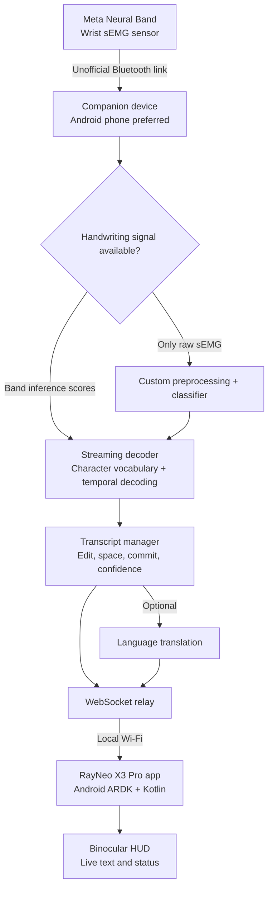

# AirWrite

**Hardware:** Meta Neural Band + RayNeo X3 Pro  
**Project type:** Wearable interaction / augmented reality / human–computer interaction  
**Status:** Proposed prototype — integration and compatibility are not yet validated on our hardware

## Overview

AirWrite is an experimental smart-glasses application that turns finger-writing movements into visible digital text. A user wears the **Meta Neural Band**, writes letters with their index finger, and sees the recognized text in a heads-up display on **RayNeo X3 Pro** glasses. The band measures wrist muscle activity using surface electromyography (**sEMG**); a recognition pipeline converts the signal or the band's own handwriting predictions into characters; and a custom glasses app renders the transcript.

**Initial scope:** Surface-assisted handwriting (writing with a finger against a table or other surface) → English text on the glasses.  
**Stretch goals:** Unsupported midair writing, full alphabet, personalized models, hands-free editing, and English ↔ Chinese text translation.

> **Terminology:** *Handwriting transcription* converts gestures into digital characters (e.g., writing H-E-L-L-O → `HELLO`). *Language translation* converts recognized text between languages (e.g., `HELLO` → `你好`). The first is the core project; the second is optional.

## Demo scenario

A student wearing the Neural Band and X3 Pro opens AirWrite. The application displays **Ready to write**. They trace `H` and `I` with an index finger on a tabletop. After each recognized character, the RayNeo display updates from `H` to `HI`. A deliberate gesture commits the word, and an optional translation mode displays `你好` only after a complete phrase is submitted.

The demonstration must function without the glasses' camera observing the fingertip. For the first milestone, **surface contact is allowed**; true midair writing is not assumed to be supported by the band's existing model.

## System architecture



### Architecture choices

- **Band integration:** The Meta Neural Band does not expose a supported general-purpose public API for third-party RayNeo applications. The project therefore relies on an *unofficial, reverse-engineered* Bluetooth integration for experimentation. Firmware and pairing changes may break it.
- **Recognition first:** Investigate the band-hosted handwriting model described by [Rokid Lumen](https://github.com/beyondlevi/rokid-lumen/blob/main/NEURALBAND.md) **before** training a replacement. Its reported outputs are 100 log-probabilities per inference sample, but this must be verified on our actual band and firmware.
- **Companion device:** Prefer an **Android phone** for the first integrated prototype because Rokid Lumen contains Rust/JNI and Android integration for band communication. A **Mac** is useful for the independent sEMG connectivity and dataset-collection experiments. Do not assume the Android handwriting bridge runs on macOS without modification.
- **Glasses:** Build a lightweight native **Kotlin** application using RayNeo's **Android ARDK** for the binocular interface. Use Unity only if true spatial/world-anchored graphics become necessary.
- **Transport:** Exchange short transcript events over a local **WebSocket**, rather than transmitting raw sEMG to the glasses. Keep inference and any credentials off the display device until direct-band support is demonstrated.

## Tech stack

| Layer                | Initial choice                                               | Purpose                                      |
| -------------------- | ------------------------------------------------------------ | -------------------------------------------- |
| Sensor               | Meta Neural Band                                             | Capture hand/finger muscle activity          |
| Band communications  | Experimental Bluetooth/L2CAP protocol; existing Rust bridge where reusable | Stream handwriting outputs or raw sEMG       |
| Companion            | Android/Kotlin + Rust/JNI; Mac/Python for isolated tests     | Pairing, streaming, decoding and text state  |
| Recognition          | Band-hosted handwriting model, if accessible                 | Character probabilities                      |
| Fallback recognition | Python/PyTorch 1D CNN or TCN                                 | Personalized air-writing classification      |
| Networking           | WebSocket over local Wi-Fi                                   | Send updates to glasses                      |
| Display              | RayNeo X3 Pro + Android ARDK                                 | Heads-up transcript UI                       |
| Validation           | Pytest, Android unit tests, timestamped recordings           | Check decoder, networking and responsiveness |

## Milestones and acceptance criteria

### M0 — Verify both devices independently

1. Confirm the exact RayNeo model, firmware, Android ARDK compatibility, and ADB access.
2. Build and install a minimal RayNeo app displaying the static text `HELLO` on both lenses.
3. Using [`callbacked/neural-band-poc`](https://github.com/callbacked/neural-band-poc), verify raw sEMG is visible on a Mac (this is **not** proof that handwriting inference is available).
4. Document how the band's unofficial pairing affects existing Meta device pairing before changing it.

**Done when:** The RayNeo app launches on hardware and a separate band demo records changing sEMG signals.

### M1 — Obtain handwriting predictions

1. Inspect Lumen's [`NEURALBAND.md`](https://github.com/beyondlevi/rokid-lumen/blob/main/NEURALBAND.md), its Rust band link, and its handwriting keyboard/decoder implementation.
2. Reproduce the handwriting mode on the Meta Neural Band using a supported host for the *unofficial* implementation; verify that the expected inference stream arrives.
3. Record test sessions for known prompts (`H`, `I`, `HELLO`) with synchronized timestamps.
4. Determine the actual output vocabulary, blank token, sequence behavior, and firmware dependencies from working code and recorded data.

**Done when:** Repeated surface-written prompts produce time-stamped inference samples that can be saved and replayed. If this cannot be achieved, switch to the fallback model path and mark the dependency as blocked.

### M2 — Decode characters and maintain a transcript

1. Implement an incremental temporal decoder based on the confirmed model vocabulary. Use the decoder already present in Lumen as a reference; do **not** assume that a simple per-frame argmax correctly resolves repeated letters.
2. Support `START`, `UPDATE`, `DELETE`, `SPACE`, `COMMIT`, and `CLEAR` operations. Confirm which band gestures are actually distinguishable while handwriting mode is active.
3. Add confidence handling only after testing whether scores are calibrated; otherwise omit numeric confidence.
4. Add unit tests for duplicate predictions, blank frames, intentional repeated letters, and reconnects.

**Done when:** A replayed writing session yields stable text; `HELLO` preserves the repeated `L`.

### M3 — RayNeo app and real-time transport

1. Start with a local test sender that emits **simulated** transcript events.
2. Build an Android glasses UI showing connection state, current editable transcript, and last committed phrase.
3. Connect a WebSocket client on the glasses to the companion over the same reachable network.
4. Add reconnect handling, monotonically increasing sequence numbers, and explicit session reset.
5. Test display placement and readability on the physical lenses, not just the Android emulator.

**Done when:** A simulated message changes the glasses display without requiring a new APK build.

### M4 — Live end-to-end handwriting demo

1. Replace the simulated sender with real band inference and the decoder.
2. Record test phrases, their ground-truth text, and event timestamps.
3. Demonstrate writing `HI` and `HELLO` on a surface and seeing the result on the glasses.
4. Evaluate character error rate (CER), end-to-end latency, false activations, and reconnection behavior.

**Done when:** The demonstration works repeatedly with the actual band and glasses, with results documented rather than estimated.

### Optional extensions

- **Air-writing:** Collect labeled, unsupported-in-midair letter movements and train an independent model; validate midair performance separately from surface writing.
- **Translation:** Add a toggle that translates **committed text**, not partial characters; keep transcription and translation separate in the UI.
- **Offline deployment:** Explore replacing the phone bridge by running the band's Bluetooth link and decoder directly on the RayNeo glasses, if hardware permissions and firmware permit it.
- **User adaptation:** Personalized calibration, language-model suggestions, delete/undo gestures, and session persistence.

## Communication protocol

The following is **our application-defined JSON**, not a Meta or RayNeo SDK protocol. A WebSocket connection carries these messages from companion to glasses:

```json
{
  "type": "transcript.update",
  "session_id": "session-001",
  "seq": 42,
  "text": "HELLO",
  "is_final": false,
  "timestamp_ms": 1794760000000
}
```

For a committed phrase:

```json
{
  "type": "transcript.commit",
  "session_id": "session-001",
  "seq": 43,
  "text": "HELLO",
  "is_final": true,
  "timestamp_ms": 1794760000100
}
```

The glasses ignore stale sequence numbers within the same session, reset state when the session changes, and render the latest text. If translation is enabled, send a separate `translation.update` event for committed text; do not overwrite the original transcription.

## Suggested repository structure

```text
airwrite/
├── README.md
├── docs/
│   ├── hardware-setup.md
│   ├── protocol.md
│   ├── evaluation.md
│   └── troubleshooting.md
├── band/
│   ├── android-bridge/       # Port/adaptation of band link
│   └── recordings/           # Local, gitignored by default
├── decoder/
│   ├── streaming_decoder.py  # Reference decoder/test harness
│   └── tests/
├── relay/
│   ├── server.py             # Prototyping transport
│   └── test_sender.py
├── glasses/
│   └── android-app/          # Kotlin, Android ARDK, HUD, WS client
├── ml/
│   ├── collect.py            # Stretch: personalized data
│   ├── train.py
│   └── evaluate.py
└── tests/
    ├── fixtures/
    └── integration/
```

**Implementation note:** The Rust band link may remain inside `band/android-bridge/` and expose JNI to Kotlin. The Python `decoder/` code can serve as a reference or test harness without requiring the final Android runtime to embed Python.

## Evaluation

| Metric               | Definition                                                   | Initial target (goal, not measured result)                  |
| -------------------- | ------------------------------------------------------------ | ----------------------------------------------------------- |
| Character error rate | `(substitutions + deletions + insertions) / reference characters` | Report on a fixed set of phrases; improve over iterations   |
| Display latency      | Time from **commit decision** to visible glasses update      | Median < 300 ms on local network                            |
| End-to-end latency   | Time from **end of writing** to rendered final text          | Measure median and 95th percentile; no guarantee in advance |
| Stability            | Consecutive successful live sessions                         | 5 demonstrations without app restart                        |
| Reconnect            | Transcript state after connection is dropped/restored        | No unintended duplicate characters                          |
| False activations    | Spurious characters during non-writing activity              | Count during a scripted idle/movement test                  |

Keep evaluation sessions distinct from training sessions for any custom model. Report whether each result refers to surface writing, unsupported air-writing, simulated transport, or live hardware.

## Known risks and constraints

1. **No official general-purpose band API:** The crucial Neural Band link is unofficial and subject to firmware, authentication, and pairing changes. The Lumen implementation was developed for **Rokid** hardware, not RayNeo; it is a technical reference, not drop-in compatibility.
2. **Handwriting-model access is unverified:** An existing open-source implementation describes an on-band model, but access and decoding must be reproduced with our own band.
3. **Surface ≠ midair:** Muscle patterns and model assumptions may differ. No midair accuracy should be claimed without data.
4. **Band ownership and credentials:** Pairing or claiming through unofficial tools may unlink the band from Meta's ecosystem. Keep band keys, auth tokens, and local recordings private; never commit them to Git.
5. **Glasses rendering:** A normal Android view may not automatically produce appropriate binocular rendering. Follow the SDK's display/activity guidance and test on-device.
6. **Research and license compliance:** Check the licenses of reference implementations and datasets before copying source or distributing trained models. Meta's generic neuromotor research release has noncommercial licensing constraints.
7. **Reliability:** BLE drops, gesture collisions, battery management, and reconnects can cause missing or repeated text. Record timestamps and raw decoder outputs to diagnose failures.

## Getting started

### Neural Band sensor-only smoke test on macOS

Requires macOS and Python 3.11; allow Bluetooth access when prompted. Review the source project's pairing directions first.

```bash
git clone https://github.com/callbacked/neural-band-poc.git
cd neural-band-poc
python3 -m venv .venv
source .venv/bin/activate
pip install -r requirements.txt
python -m dashboard.server
```

Open `http://localhost:8765`, find the band, and select its sEMG mode. This establishes a **raw-signal connectivity baseline** only.

### RayNeo application smoke test

Use [RayNeo Open Platform](https://open.rayneo.com/) and the [RayNeo X3 Pro development guide](https://www.qualcomm.com/developer/project/get-started-with-rayneo-x3-pro-ar-development) for the SDK, firmware-specific setup, and ADB instructions. Once debugging is enabled and the app is built:

```bash
adb devices
adb install -r path/to/app-debug.apk
```

Launch the installed app using the supported glasses launcher if needed; verify that text appears correctly on the device.

### Prioritize this integration path

**RayNeo static HUD → simulated WebSocket updates → Lumen-style handwriting inference on a companion → streaming decoder → live end-to-end demo.**

This order isolates display, networking, and band/ML failures. Avoid simultaneously building a new model and reverse-engineering the Bluetooth protocol unless the existing inference route is blocked.

## References

- [RayNeo Open Platform — SDKs and device documentation](https://open.rayneo.com/)
- [Qualcomm — Get Started with RayNeo X3 Pro AR Development](https://www.qualcomm.com/developer/project/get-started-with-rayneo-x3-pro-ar-development)
- [beyondlevi/rokid-lumen — integrated Neural Band + third-party glasses implementation](https://github.com/beyondlevi/rokid-lumen)
- [Rokid Lumen — Neural Band technical notes and handwriting stream](https://github.com/beyondlevi/rokid-lumen/blob/main/NEURALBAND.md)
- [callbacked/neural-band-poc — Mac raw sEMG proof of concept](https://github.com/callbacked/neural-band-poc)
- [facebookresearch/generic-neuromotor-interface — sEMG research models and datasets](https://github.com/facebookresearch/generic-neuromotor-interface)

---

**Project success definition:** A reproducible, measured live demonstration in which handwriting movements detected through the Meta Neural Band are displayed as digital text inside a RayNeo X3 Pro app, with clear documentation of whether recognition relies on surface writing, a pre-existing band model, or a newly trained classifier.